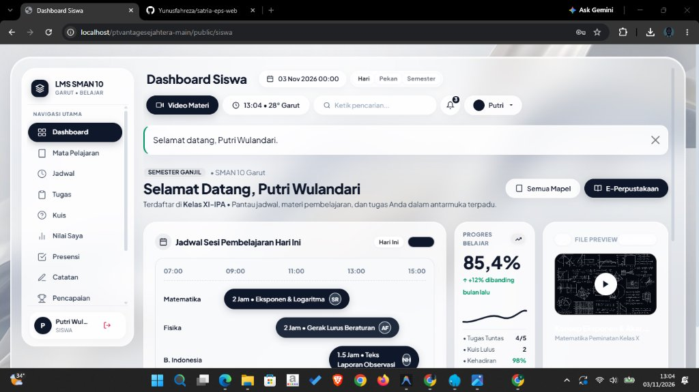

# LMS SMAN 10 Garut

Platform **Learning Management System (LMS)** modern, aman, dan berorientasi *User Experience* tinggi untuk SMAN 10 Garut. Menyatukan ruang belajar digital, materi modul, penugasan berbatas waktu, kuis online otomatis, video interaktif, presensi kehadiran, e-perpustakaan, serta buku nilai analitik dengan visualisasi grafik interaktif dalam estetika *Subtle Glassmorphism*.

[](https://php.net)
[](https://github.com)
[](https://mysql.com)
[](https://github.com)
[](https://getbootstrap.com)
[](https://chartjs.org)
[](https://github.com)
[](https://laragon.org)

---

## Tampilan Antarmuka



---

## Sorotan Fitur

- **Subtle Glassmorphism Cockpit UI:** Antarmuka modern pulau melayang (*floating islands*), efek frosted glass (*backdrop blur*), tipografi *Plus Jakarta Sans*, dan latar visual cairan 3D realistis.
- **Buku Nilai & Analitik Interaktif:** Rangkuman statistik IPK kumulatif, distribusi grade (A/B/C/D), tingkat ketuntasan KKM, serta grafik performa mapel, tren linimasa, dan komparasi tugas vs kuis berbasis Chart.js.
- **Portal 3 Peran Terpadu:**
  - **Siswa:** Dashboard terpadu, materi & video, pengumpulan tugas, kuis online dengan timer server, presensi, catatan belajar, lencana prestasi (*badges*), e-perpustakaan, dan kalender akademik.
  - **Guru:** Manajemen bahan ajar, tugas & penilaian umpan balik, pembuat kuis & bank soal pilihan ganda, perekaman absensi, rekap nilai ekspor CSV Excel, dan pengumuman kelas.
  - **Admin:** Master tahun ajaran, kelas, mata pelajaran, penugasan guru pengampu, jadwal mingguan, dan manajemen pengguna lengkap dengan impor CSV massal.
- **Data Pembelajaran Realistis (1,5 Semester):** Dilengkapi seeder data akademik siap pakai mencakup Semester Genap 2025/2026 dan Semester Ganjil 2026/2027 hingga posisi waktu berjalan.

---

## Hak Akses & Peran Pengguna

Sistem mengimplementasikan otentikasi sesi terpusat dengan *Role-Based Access Control* (RBAC) pada setiap modul dan rute aplikasi:

- **Administrator:** Akses penuh untuk konfigurasi tahun ajaran, penjadwalan kelas, pemetaan pengampu, impor data pengguna secara massal, dan pemantauan sistem sekolah secara menyeluruh.
- **Guru:** Akses mandiri untuk mengelola materi ajar, mempublikasikan tugas dan kuis online, memantau pengumpulan tugas siswa, menilai hasil asesmen dengan umpan balik, dan mengekspor rekapitulasi nilai.
- **Siswa:** Akses portal terpadu untuk mengikuti kegiatan belajar harian, mengakses modul dan video pembelajaran, mengunggah tugas tepat waktu, mengerjakan kuis interaktif, serta meninjau rekapitulasi kehadiran dan grafik analitik nilai pribadi.

> *Kredensial dan kata sandi akun dikelola secara aman di dalam basis data sekolah atau dapat dibuat melalui menu Manajemen Pengguna di panel Administrator.*

---

## Arsitektur & Keamanan

- **Zero-Dependency Core:** Dibangun menggunakan pola arsitektur MVC murni berbasis OOP PHP native tanpa framework berat pihak ketiga.
- **Anti SQL Injection:** Akses data 100% menggunakan *PDO Prepared Statements*.
- **Anti XSS:** Sanitasi output konteks HTML melalui helper `e()` (`htmlspecialchars`).
- **Anti CSRF:** Token proteksi unik terintegrasi pada setiap form mutasi data POST.
- **Otentikasi Kredensial:** Algoritma pengacakan `password_hash()` (Bcrypt) dan proteksi *brute-force rate limiter*.
- **File Gatekeeper:** Unggahan berkas terisolasi di direktori `uploads/` dengan validasi ekstensi, MIME type riil (`finfo`), dan proteksi akses controller.

---

## Petunjuk Instalasi Cepat

### 1. Kloning Proyek
Tempatkan folder proyek pada lingkungan web server lokal (Laragon / XAMPP):
```bash
# Contoh direktori Laragon
cd C:/laragon/www
git clone <url-repository-anda> ptvantagesejahtera-main
```

### 2. Impor Basis Data
Buat basis data MySQL dan impor skema lengkap:
```bash
mysql -u root -p -e "CREATE DATABASE IF NOT EXISTS lms_sma;"
mysql -u root -p lms_sma < database/lms_lengkap.sql
```

*(Opsional)* Jalankan seeder 1,5 semester untuk mengisi riwayat presensi, tugas, nilai, dan kuis:
```bash
php database/seeder_1_setengah_semester.php
```

### 3. Konfigurasi Lingkungan
Salin file konfigurasi contoh dan sesuaikan kredensial MySQL bila diperlukan:
```bash
cp config/config.example.php config/config.php
```

### 4. Buka di Browser
Akses aplikasi melalui browser:
```
http://localhost/ptvantagesejahtera-main/public
```

---

## Struktur Folder Ringkas

```text
├── app/
│   ├── controllers/      # Controller logika bisnis (Admin, Guru, Siswa, dll.)
│   ├── core/             # Framework engine (Router, Model, View, Auth, Csrf, Database)
│   ├── models/           # Data access layer PDO (User, Mapel, Tugas, Kuis, Absensi, dll.)
│   └── views/            # Template tampilan Glassmorphism & antarmuka terpadu
├── config/               # Berkas konfigurasi aplikasi & database
├── database/             # Skema SQL awal & seeder pembelajaran 1,5 semester
├── docs/                 # Aset dokumentasi & tangkapan layar tampilan
├── public/               # Web root (index.php, aset CSS, JS Chart.js, gambar 3D)
└── uploads/              # Direktori penyimpanan berkas tugas & modul terlindungi
```

---

Dikelola untuk **SMAN 10 Garut** &bull; Hak Cipta &copy; 2026 PT. Vantage Sejahtera.
